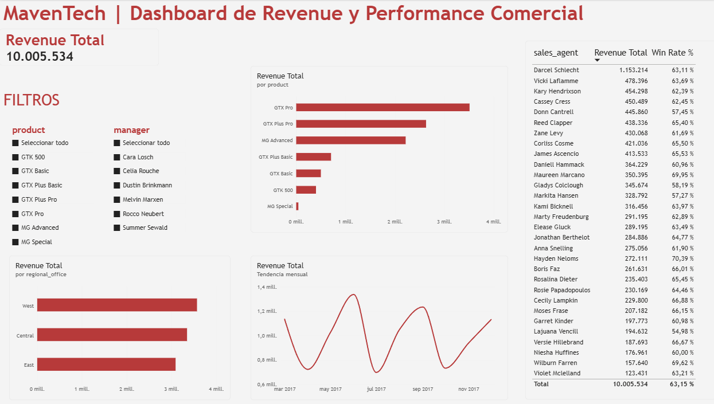

# Revenue Analytics CRM MavenTech

Análisis de revenue y performance comercial sobre el dataset público **CRM Sales Opportunities** (Maven Analytics), un caso ficticio de una empresa B2B de hardware de computación llamada MavenTech.

El objetivo del proyecto fue recorrer un flujo completo de Revenue Analytics, desde la carga de datos crudos hasta un dashboard ejecutivo, replicando el mismo análisis en 3 herramientas distintas para demostrar consistencia entre ellas.

## Stack utilizado

- **PostgreSQL**, modelado relacional y queries de negocio con SQL
- **Python (pandas)**, limpieza de datos, EDA y validación de resultados
- **Power BI**, modelado del dataset y dashboard interactivo

## Dashboard final

## Qué incluye este repositorio

- `load_data.py`, script que crea el esquema relacional en PostgreSQL (con foreign keys entre las 4 tablas) y carga los CSV originales
- `eda.ipynb`, notebook con la exploración de datos, detección y corrección de inconsistencias
- `queries.sql`, queries de negocio sobre PostgreSQL, con el resultado e insight de cada una documentado como comentario

## Proceso de limpieza de datos

Durante el EDA se detectaron y corrigieron 2 inconsistencias de escritura en los datos originales

- `sales_pipeline.product`, el valor `GTXPro` no coincidía con `GTX Pro` de la tabla de productos, lo que rompía la relación entre tablas
- `accounts.sector`, el valor `technolgy` estaba mal escrito, corregido a `technology`
- `accounts.office_location`, el valor `Philipines` estaba mal escrito, corregido a `Philippines`

Los nulos encontrados en `sales_pipeline` (`close_date`, `close_value`, `account`, `engage_date`) se investigaron y se confirmó que todos responden a una lógica de negocio válida, oportunidades que todavía no cerraron o que están en etapas tempranas del pipeline, no son errores de carga.

## Insights principales

- Revenue total ganado, **10.005.534**, sobre 10 meses de operación (marzo a diciembre de 2017)
- **GTX Pro** es el producto líder, genera más de un tercio del revenue total
- El win rate está parejo entre productos (60% a 65%), la diferencia de revenue entre ellos viene del volumen de ventas y el precio, no de qué tan bien se venden
- El top performer en revenue (Darcel Schlecht, 1,15M) tiene un win rate similar al promedio del equipo, su resultado se explica por gestionar un volumen de pipeline mucho mayor que el resto, no por mejor conversión
- Revenue bastante parejo entre las 3 regiones comerciales (West, Central, East)

## Cómo reproducirlo

1. Crear una base PostgreSQL llamada `revenue`
2. Definir las variables de conexión en un archivo `.env` (no incluido en el repositorio por seguridad)
3. Correr `load_data.py` para crear las tablas y cargar los CSV originales del dataset
4. Abrir `eda.ipynb` para ver el proceso de limpieza paso a paso
5. Correr las queries de `queries.sql` sobre la base ya cargada
6. Conectar Power BI Desktop a la base PostgreSQL para reconstruir el dashboard
